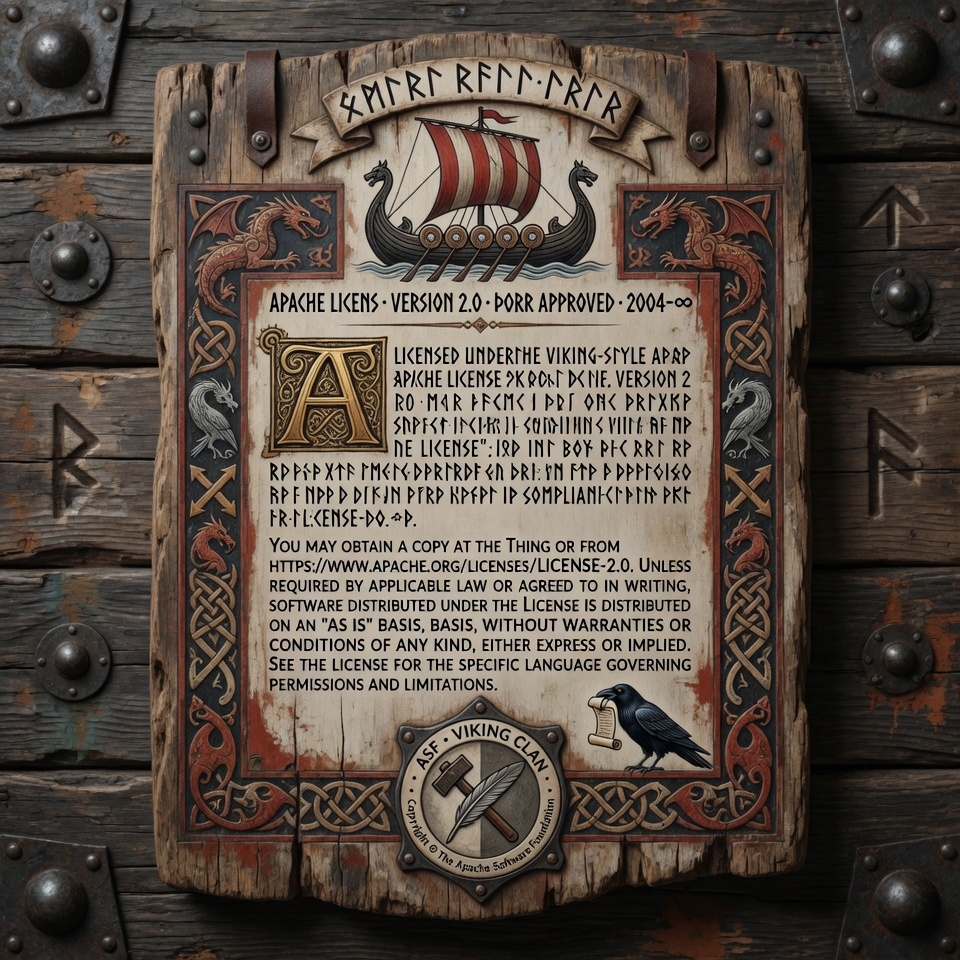

---

# ⚔️ Mythic Agent CLI ⚔️

Welcome to **Mythic Agent**, an ultra-advanced, Viking-themed AI coding assistant right in your terminal. Designed with both intuition and rigorous architecture in mind, Mythic Agent is more than just a chatbot—it is a complete, multi-agent forge capable of managing entire repositories, running shell commands, coordinating sub-agents, and embracing the true spirit of the **Mythic Engineering** protocol.

---

## 🌟 Key Features

### 🛡️ The Viking TUI (Terminal User Interface)
Built on `Textual`, Mythic Agent features a gorgeous, fully interactive TUI styled with the **Tokyo Night** theme. Command your agent with a beautiful, heavy-bordered aesthetic, all from the comfort of your command line.

### 🧠 Mythic Engineering Mode
Enable the **Mythic Engineering Mode** directly from the sidebar to supercharge your AI. Following the MD Protocol, the agent switches to an **Architecture-First** mindset and delegates complex tasks to six highly specialized, built-in Sub-Agents:
1. **Skald** - The Visionary Poetess
2. **Architect** - The Dominant Designer
3. **Forge Worker** - The Fiery Builder
4. **Auditor** - The Merciless Verifier
5. **Cartographer** - The Sensual Wayfinder
6. **Scribe** - The Gentle Guardian of Memory

### 🐙 Seamless GitHub Integration
Forget switching contexts to authenticate or run raw git commands. 
- Easily configure your GitHub Repo and Personal Access Token (PAT) directly inside the TUI.
- Instantly use high-level slash commands:
  - `/commit <message>` - Automatically stages, commits, and pushes to remote.
  - `/issue <title>` - Instantly opens a GitHub issue.
  - `/pr <title>` - Instantly creates a Pull Request.
  - `/status` - Checks your local Git status.
  - `/gh <command>` - Runs raw GitHub CLI commands automatically authenticated via your saved PAT.

### 🛠️ Advanced Claude-Code Capabilities
Mythic Agent incorporates premium developer features:
- **Command Approvals:** Any destructive or terminal command the AI wishes to run requires your explicit approval via a modal.
- `/doctor` - Automatically catches terminal errors and fixes them.
- `/undo` - Restores the last unchanged agent file edit from its workspace journal.
- `/add <file>` - Explicitly pull specific files into the agent's context.

### 🌐 Multi-Provider Divine Sources
Mythic Agent supports multiple LLM endpoints out of the box. Easily configure:
- OpenRouter (for Claude 3.5 Sonnet, Llama 3, etc.)
- DeepSeek
- OpenAI
- OpenCode Go

### 🆕 Recent Features
- **`mythic doctor`** — System health checks (config, providers, tools, sessions, disk, dependencies) with `--json` for machines, `--fix` for safe auto-repairs, and `--live` for opt-in live provider checks.
- **Agent lifecycle & orchestration** — Typed task IDs with queued/running/completed/failed/cancelled states, delegation-cycle detection, cancellation propagation, and per-agent turn/tool budgets. Inspect via the MCP `mythic_task_status` / `mythic_task_cancel` tools.
- **`mythic cache`** — Inspect or clear the LLM response cache (`--stats`, `--clear`) so you never pay twice for identical requests.
- **`mythic costs`** — A model API cost ledger per workspace; unknown pricing is reported as unknown, never invented.
- **`mythic metrics`** — Recorded timers, counters, gauges, and traces for the workspace.
- **`mythic review`** — Static review of Python files with severity filtering and JSON output.
- **`mythic theme`** — List and apply color themes for the interface.
- **`mythic tutorial`** — Interactive first-run tutorial from any terminal.
- **Shell completions** — Ready-made completions for bash, zsh, and fish in `completions/`.
- **MCP server (`mythic-mcp`)** — External AI agents get the same workspace/policy/session/task services over stdio, with versioned tool contracts.
- **`mythic sessions --search`** — Filter workspace sessions by id, status, model, or metadata.

See the [User Guide](docs/USER_GUIDE.md) and [API reference](docs/API.md) for the full tour.

---

## 🧭 Current Development Status | 6 November 2026

> **Active alpha, rapidly advancing, not yet a verified stable release.** This is a source-and-repository-evidence snapshot of the feature campaign through **M-080**, reviewed against the committed Python implementation, test inventory, recent commits/merges, roadmap data and hosted CI history. It is **not** a claim that a fresh end-to-end test suite, live provider test or cross-platform release gate was run on this exact revision.

### 📊 Progress at a glance

| Measure | Verified repository state |
| --- | --- |
| All-Features campaign | **80 / 272 slices marked done (29.4%)**; **192 queued** in [the machine-readable roadmap](mythic_agent/data/roadmap_slices.yaml) |
| Finished campaign parts | **I: Census & Charter (M-001–018), II: Provider Ocean (M-019–042), III: Code Intelligence (M-043–070)** |
| Active campaign part | **IV: The Editor's Hand (M-071–094)**, with M-071–080 marked done (**10 / 24**) |
| Next planned slice | **M-081: Conflict workbench**, followed by PR craft (M-082), issue-to-slice (M-083) and named multi-file change sets (M-084) |
| Separate elder roadmap | **MIM-001–050 of 500** receipted in the Mímisbrunnr programme; **MIM-051–500** remain unreceipted. These are *not* additive to the 80 M-slices; see the [concordance](docs/CONCORDANCE_MIMISBRUNNR_FEATURE_ROADMAP.md). |
| Package version | **0.1.0**, from [the version source](mythic_agent/__version__.py); alpha source project, **no GitHub release published** at this snapshot |
| Repository scale | **568 tracked files**, including **401 Python files** and **171 maintained Python test files**; [public API inventory](docs/PUBLIC_API.md) lists **2,620 public names** (inventory, *not* a stability guarantee) |
| Branch and integration status | Development occurs on the default `development` branch; the latest code was merged to `main` via [PR #7](../../pull/7) on **2026-11-06**. Code reviewed through `1e8237c` (`development`) and its subsequent `main` merge. |

### ⚒️ What the codebase has actually gained

**The working foundation.** The package has a real `mythic` entry point, optional Textual TUI, interactive terminal chat, machine-readable `mythic run`, workspace-scoped sessions, journaled file edits, user approval policies, cancellable execution, task/sub-agent tracking, an MCP server entry point, diagnostics, cost/metrics tools and optional memory/context capabilities. The [architecture](ARCHITECTURE.md), [CLI guide](docs/CLI.md), [user guide](docs/USER_GUIDE.md) and [development progress record](docs/development/PROGRESS.md) describe the contracts and their earlier evidence. The configurable six-agent Mythic Engineering cast is part of the existing product; making the complete Forge Protocol the universal autonomous operating loop remains later roadmap work.

**Provider expansion, M-019–042.** [The adapter registry](mythic_agent/providers/registry.py) now names **16 provider/endpoint adapters**, including OpenAI, Anthropic, Google, DeepSeek, OpenRouter, Ollama, LM Studio, llama.cpp, vLLM and Project Aesir. The work includes capability negotiation, structured output, tools, vision, reasoning, streaming, usage/cost accounting, retries, health and fallback mechanics. **Registered ≠ live-verified**: credentials, actual provider behavior, optional dependencies and hardware-specific compatibility still require individual proof.

**Code intelligence, M-043–070.** Tree-sitter foundations, repository maps, symbol graphs, structural search/rewrite, LSP diagnostics/navigation/rename, debugging through DAP, test feedback, code-sensing and specialised source views are represented by implementation modules and regression tests. [The Part III gate](mythic_agent/data/part3_gate.yaml) records a **PASS using controlled throwaway repositories and fake protocol-speaking LSP/DAP servers**. That proves the tested integration shapes; it does **not** establish that every real language server, debugger adapter or platform was exercised.

**The Editor's Hand, M-071–080.** The newest integrated feature wave is especially substantial:

| Slice | Implementation now present |
| --- | --- |
| **M-071** | Several strict edit formats: whole-file, unified-diff, search/replace and architect/editor planning |
| **M-072** | Hash-anchored file edits that reject stale or changed targets |
| **M-073** | Bounded repair packets with true current-text context after failed edits |
| **M-074** | Per-hunk accept/reject/edit review, followed by journaled application |
| **M-075** | Named working-tree and session checkpoints, branching checkpoint history and guarded restore |
| **M-076** | Fork, inspect and compare persistent session branches |
| **M-077** | Expanded undo timeline for edits, recorded command footprints and checkpoints, with certainty explicitly qualified |
| **M-078** | Opt-in auto-commit planning on a working branch, with protected-branch rules |
| **M-079** | README and licence file guardians in the edit journal, with an explicit-authorisation override |
| **M-080** | Diff-grounded commit splitting/message drafting plus safer push discipline, including remote checks and post-push verification |

The new implementation is visible in [`core/`](mythic_agent/core), with command paths in [the handler](mythic_agent/agents/command_handler.py), [terminal](mythic_agent/terminal.py) and [TUI](mythic_agent/ui/screens/chat_screen.py). Dedicated tests include `test_checkpoints.py`, `test_session_branching.py`, `test_undo_timeline.py`, `test_auto_commit.py`, `test_file_guardians.py` and `test_commit_craft.py`. The [current defaults](mythic_agent/data/config_defaults.yaml) enable checkpoints, branching, expanded undo, hunk review and commit craft, while **auto-commit remains off by default** and explicit guardian permission remains off by default.

### 🧪 Quality and release-readiness: evidence, not wishful thinking

- **Local campaign receipts:** [`CAMPAIGN_STATE.md`](CAMPAIGN_STATE.md) records M-075's whole-suite confirmation as **3,884 passed, 3 failed, 1 skipped** (3,888 collected). Its authors classified two failures as environment-specific and the third as a ledger-consistency failure addressed by the closing record. **That is a historical receipt, not a clean run on M-080.** Newer M-076–080 closure commits, tests and regenerated roadmap/API/ownership inventories are present, but the root campaign's detailed closure narrative has not yet been extended to M-080.
- **Hosted CI is not currently green or current.** The latest visible [Actions run, 22 October 2026](../../actions/runs/39840813835), failed across **all six** Linux/macOS/Windows × Python 3.10/3.13 jobs. Sample logged causes include coverage-report parsing, ownership-map assertions and Windows test collection failing because `tests/test_session_identity.py` imports POSIX-only `fcntl` unconditionally. That import is still in the reviewed source. The current [workflow](.github/workflows/ci.yml) uses **manual `workflow_dispatch` only**; recent November commits therefore do not prove a fresh hosted matrix.
- **Tests and generated inventories are extensive but distinct from release approval.** `tests/` contains 171 Python test modules, and [`PUBLIC_API.md`](docs/PUBLIC_API.md) plus [`OWNERSHIP.md`](docs/OWNERSHIP.md) were regenerated on 6 November. No complete suite, wheel-install matrix, real-provider matrix or physical cross-platform acceptance test was independently executed as part of *this README audit*.
- **Release documentation needs a reconciliation pass.** [`ROADMAP.md`](ROADMAP.md), [`docs/development/PROGRESS.md`](docs/development/PROGRESS.md) and [`docs/RELEASE_CHECKLIST.md`](docs/RELEASE_CHECKLIST.md) still carry older checkpoints/results. [The 272-slice roadmap's introduction](docs/MYTHIC_CODER_FEATURE_ROADMAP_2026-10-30.md) calls the repository “AGPL”, whereas the actual [`LICENSE`](LICENSE), [`pyproject.toml`](pyproject.toml) and this README currently identify **Apache-2.0**. This is a *documentation inconsistency*, not a licence change; resolve it deliberately without silently editing legal files.

### 🧱 What is next, and what is **not** finished

**Immediate engineering queue:** begin **M-081 conflict workbench**; then M-082–094 progressively finish the Git/PR, review, large-file, patch and editor experience, ending in the **Part IV acceptance gate**. For a release-quality baseline, also fix the Windows `fcntl` test portability issue, re-run the full suite, regenerate/verify the source inventories, run the six-platform/Python-version CI matrix on the **exact candidate commit**, and update the campaign ledger and release checklist with reproducible evidence.

**Later major parts remain queued:** Part V autonomy/permissions and **native OS sandboxing** (M-095–120); Part VI collaborative agent crews (M-121–146); Part VII memory/context (M-147–170); Part VIII UX (M-171–200); Part IX Mythic Engineering as the governing workflow (M-201–226); Part X extensions/integrations (M-227–252); and Part XI final reliability, security, privacy and release gates (M-253–272). The current shell denylist/timeouts and permission checks should **not** be mistaken for the future M-097 kernel/OS confinement boundary.

**How to read progress:** `done` in [the slice ledger](mythic_agent/data/roadmap_slices.yaml) means the campaign has banked that slice, **not** that the complete product is stable, every model has been tested live, every GitHub Actions job is green or all future roadmap gates are met. For detailed priorities and historical receipts, consult [the governing 272-slice roadmap](docs/MYTHIC_CODER_FEATURE_ROADMAP_2026-10-30.md), [the campaign state](CAMPAIGN_STATE.md), [the elder 500-slice roadmap](MYTHIC_AGENT_CODER_CLI_500_SLICE_ULTIMATE_MIMISBRUNNR_ROADMAP.md) and [the concordance](docs/CONCORDANCE_MIMISBRUNNR_FEATURE_ROADMAP.md).

*Audit scope: default-branch repository tree, package/test/module inventory, core implementations and entry-point wiring, YAML status, project documents, recent commit history, merged PRs, GitHub Actions runs and representative job logs. No source files, licence files, generated inventories or tests were changed for this status report.*

---


---


---

## 🚀 Installation & Setup

1. **Clone the repository:**
   ```bash
   git clone https://github.com/hrabanazviking/Mythic_Agent_Coder_CLI.git
   cd Mythic_Agent_Coder_CLI
   ```

2. **Install the CLI globally:**
   ```bash
    pip install -e '.[tui]'
   ```

3. **Summon the Agent:**
   ```bash
   mythic
   ```

### First-Time Configuration

Core-only installation uses `pip install -e .` and supports `mythic chat`,
`mythic run`, `mythic --help`, and `mythic --version` without UI or speech packages.
Use `mythic run --format json "your task"` for AI callers; it defaults to read-only.
See [the human/machine CLI guide](docs/CLI.md) for permissions, stdin, JSONL and
durable workspace sessions (`--resume`, `mythic sessions --export`), recovery and
exit codes. Optional integrations are
installed with the `mcp`, `knowledge`, `voice`, and `voice-cloning` extras.
Human TUI/terminal and machine callers share tool permissions. Ctrl+C in terminal
or `/stop` in TUI cancels active owned requests, approvals and commands; command
results include exit status and captured output. Direct/machine effects require
an explicit policy; delegated agents inherit the caller's mode.
See [the development roadmap](ROADMAP.md) for active reliability work and
[the developer guide](docs/DEVELOPMENT.md) for test/build commands. This is an
alpha; roadmap features are only available once their implementation is recorded.

When you run `mythic` for the first time, press **`F2`** to open the **Setup Wizard**.
Here, you can:
- Select your Provider and enter your API Key.
- Fetch and select the desired AI Model.
- Edit the primary System Prompt (By default: A super smart, pretty, modern Viking female coder).
- Add Global Rules that apply to all sub-agents.
- Summon custom Warriors (Sub-Agents) or use the default Mythic Engineering team.

---


---

## 📜 How to Use

Simply launch `mythic` in your project's directory and type naturally! You can ask the agent to:
- `"Read my src/main.py and find the bug."`
- `"Create a new React component for a login screen."`
- `"Run the tests and fix any failing ones."`

### Runic Commands (Slash Commands)
You can type these at any time in the chat input:
- `/help` - View all available commands.
- `/setup` (or `F2`) - Open the Setup Wizard.
- `/clear` - Clear the current conversation history.
- `/add <file>` - Add a specific file to the context.
- `/commit <msg>` - Auto-commit and push changes to GitHub.
- `/issue <title>` - Create a GitHub issue.
- `/pr <title>` - Create a GitHub Pull Request.
- `/status` - Check Git status.
- `/gh <cmd>` - Run native GitHub CLI commands.
- `/test` - Run your project's test suite natively.
- `/undo` - Roll back the last agent file edit.
- `/doctor` - Auto-fix a command output.
- `/quit` - Leave Valhalla (Exit the app).

---


---


---


---


---


---



---

## ⚖️ License

Copyright (c) 2026 Volmarr Wyrd

Mythic Agent Coder CLI is licensed under the **Apache License, Version 2.0**. See the [LICENSE](LICENSE) file for the full license text and [NOTICE](NOTICE) for the project attribution.

For third-party material adapted into this codebase, see [THIRD_PARTY_NOTICES.md](THIRD_PARTY_NOTICES.md). Per the Apache-2.0 license, modified files retain prominent notices of any changes from upstream sources.

Unless required by applicable law or agreed to in writing, this project is distributed on an "AS IS" BASIS, without warranties or conditions of any kind, either express or implied.

---

## Distribution and Privacy Position

Mythic Agent Coder CLI is published here as source code and project material.

The author does not require users to provide age, identity, government ID, biometric data, or similar personal information in order to access or use the source code in this repository.

The author may decline to provide official binaries, installers, hosted services, app-store releases, or other official distribution channels where doing so would require age verification, identity verification, or similar personal-data collection.

Any third party who forks, packages, redistributes, deploys, hosts, or otherwise makes this software available does so independently and is solely responsible for compliance with applicable law, platform policy, and distribution requirements in their own jurisdiction and context.

See [LEGAL-NOTICE.md](LEGAL-NOTICE.md) for details.

---

## ☕ Support the Project

If you enjoy my open-source projects and want to help support continued development, research, testing, and experimentation, you can leave a tip through PayPal:

**[Support my work on PayPal.Me](https://www.paypal.com/paypalme/volmarrwyrd)**

Support is always appreciated, but never required. Using, sharing, testing, contributing to, or starring the projects helps too. 🖤⚙️ᚱ

---


---


---
